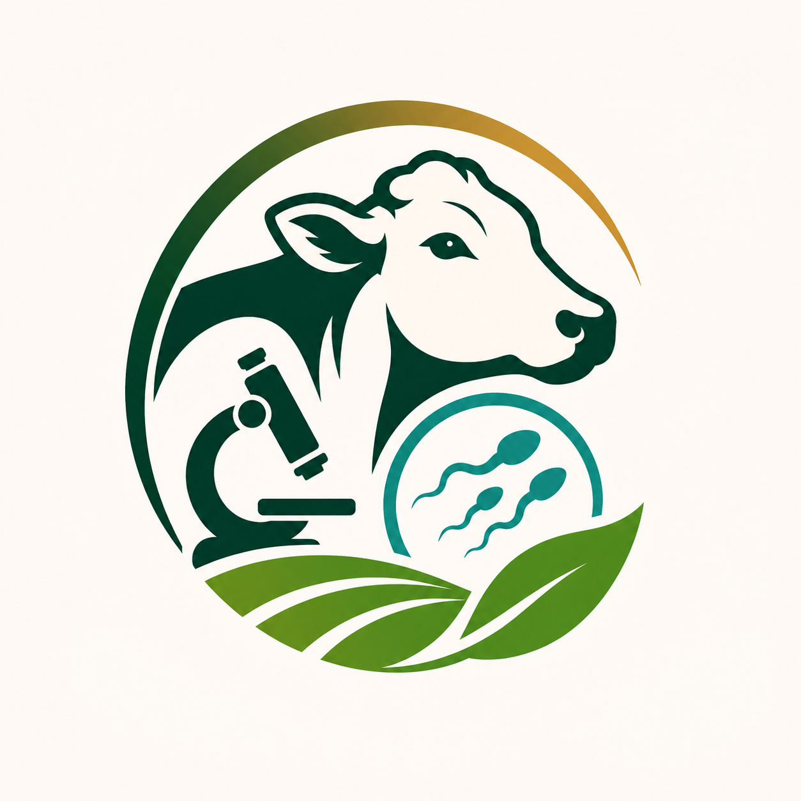

<div align="center">
  
  <h1>Calidad del semen bovino</h1>
  <p><strong>Conocer para cuidar.</strong> Una experiencia educativa en español para explorar los factores que pueden relacionarse con la calidad seminal de un toro reproductor.</p>
  <p><a href="https://calidad-seminal-bovina.vercel.app/">Visitar la web</a> · <a href="https://calidad-seminal-bovina.vercel.app/#factores">Explorar los factores</a> · <a href="https://calidad-seminal-bovina.vercel.app/#recursos">Revisar las fuentes</a></p>
</div>

<p align="center">
  
</p>

> **Alcance:** es una herramienta de divulgación científica en revisión académica. Sus indicaciones son criterios educativos provisionales: no diagnostican fertilidad, no sustituyen una evaluación andrológica y no calculan una puntuación global.

## Qué puedes hacer

- **Conocer cinco factores:** ambiente, nutrición, salud, características del reproductor y manejo reproductivo. Cada escena permite seleccionar puntos de interés y leer una explicación práctica.
- **Explorar «Mi caso»:** responder 18 preguntas en cinco grupos, cambiar de grupo sin perder las respuestas de la visita y elegir «No sé» cuando falte información.
- **Consultar «Mis puntos»:** ver cada condición por separado, con una indicación, una explicación comprensible, una acción sugerida y sus fuentes. Las respuestas desconocidas se muestran como información insuficiente.
- **Abrir el laboratorio interactivo:** comparar motilidad, morfología y concentración mediante simulaciones educativas sin escala. Incluye movimiento controlable, un modelo 3D y una alternativa estática cuando 3D no esté disponible.
- **Revisar la bibliografía:** acceder a 13 publicaciones y guías que aportan contexto científico y técnico.

El contenido educativo se puede recorrer sin completar el cuestionario. Las fotografías de contexto se generaron con IA; las animaciones representan conceptos y no son imágenes ni mediciones de muestras reales.

## Ejecutarlo en tu equipo

Necesitas **Python 3** para el servidor local y **Node.js** para las comprobaciones. El proyecto no tiene dependencias que instalar ni requiere cuentas, API o base de datos.

```bash
git clone https://github.com/Pochonski/calidad-seminal-bovina.git
cd calidad-seminal-bovina
npm run dev
```

Abre [http://127.0.0.1:4173](http://127.0.0.1:4173). Para ejecutar las pruebas y la comprobación de sintaxis:

```bash
npm run check
```

También puedes servir `dist/` con cualquier servidor HTTP estático. Los módulos JavaScript necesitan HTTP; abrir `index.html` mediante `file://` no es suficiente.

## Cómo está construido

| Parte | Función |
| --- | --- |
| [`dist/index.html`](dist/index.html) y hojas CSS en [`dist/`](dist/) | Estructura, navegación y diseño adaptable. |
| [`dist/app.js`](dist/app.js) | Rutas, formulario, resultados y estado de la visita. |
| [`dist/content.js`](dist/content.js) | Factores, preguntas, opciones, explicaciones, recomendaciones, fuentes y criterios por condición. |
| [`dist/factor-scenes.js`](dist/factor-scenes.js) | Escenas interactivas de los cinco factores. |
| [`dist/science-visuals.js`](dist/science-visuals.js) | Interfaz y simulaciones 2D del laboratorio educativo. |
| [`dist/science-3d.js`](dist/science-3d.js) y [`dist/vendor/three/`](dist/vendor/three/) | Modelo de morfología en Three.js, servido junto con la web. |
| [`tests/`](tests/) | Pruebas de criterios, escenas y visualizaciones. |
| [`docs/criterios-revision.md`](docs/criterios-revision.md) | Matriz completa de preguntas, respuestas, indicaciones y fuentes para revisión docente. |

Es una web estática de **HTML, CSS y JavaScript**. No hay proceso de compilación: `dist/` contiene la versión lista para servir. Las imágenes se incluyen en el repositorio, con variantes WebP para distintos tamaños de pantalla.

## Criterios, privacidad y accesibilidad

Las 18 preguntas reúnen 66 opciones. Cada respuesta se interpreta de forma independiente como **adecuada según lo declarado**, **merece atención**, **requiere mayor atención**, **información insuficiente** o **dato de contexto**. Ninguna indicación establece por sí sola el estado del semen. La edad y la modalidad de monta se registran como contexto; «No sé» y las respuestas ausentes nunca producen un resultado favorable. La [matriz de revisión](docs/criterios-revision.md) explica cada regla y su fuente.

Las respuestas se conservan en `sessionStorage` durante la visita a esa pestaña. No se solicitan datos personales ni se envían respuestas a un servidor. El formulario permite volver a pasos anteriores y limpiar todas las respuestas.

La interfaz incluye controles con etiquetas, navegación por teclado, indicaciones que no dependen solo del color y soporte para la preferencia de movimiento reducido. Las animaciones se detienen fuera de pantalla o cuando la pestaña está oculta; el modelo 3D dispone de una representación estática alternativa.

## Publicación y revisión

La rama `main` se despliega automáticamente en [Vercel](https://calidad-seminal-bovina.vercel.app/) mediante la integración con GitHub. [`vercel.json`](vercel.json) ejecuta `npm run check` y publica `dist/`. La web es accesible mediante su enlace y mantiene `noindex` mientras se revisa el contenido académico.

Las referencias respaldan el contexto general, pero **no validan el cuestionario ni sus niveles de atención**. Las correcciones científicas o editoriales deben contrastarse con las fuentes y actualizar tanto [`dist/content.js`](dist/content.js) como la [matriz de criterios](docs/criterios-revision.md). Antes de proponer cambios, ejecuta `npm run check`.

## Autores

- Dikson Aarón Guzmán Sibaja · [ORCID](https://orcid.org/0009-0004-0368-7781)
- José Ángel Aguirre Reyes · [ORCID](https://orcid.org/0009-0001-4447-772X)
- Joseph Fonseca Nuñez · [Portafolio](https://joseph-fonseca-dev.vercel.app/) · [LinkedIn](https://www.linkedin.com/in/joseph-fonseca-n/)

Proyecto académico del **Instituto Tecnológico de Costa Rica, Campus Local San Carlos**. La identificación institucional no implica aprobación de la herramienta ni de sus criterios.
